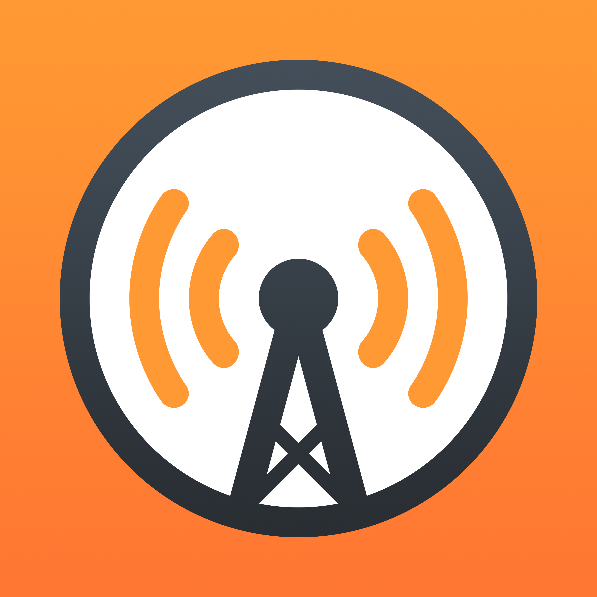
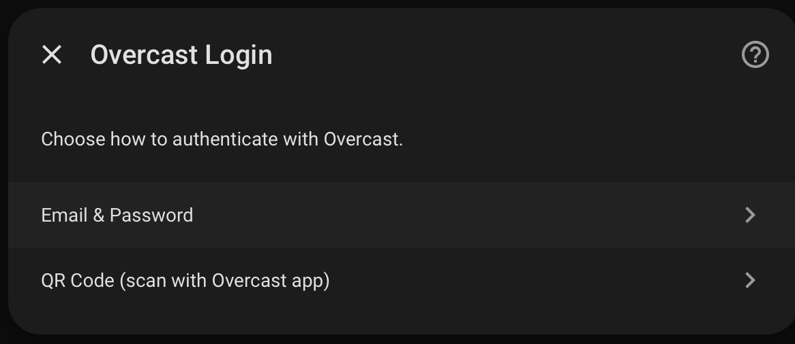
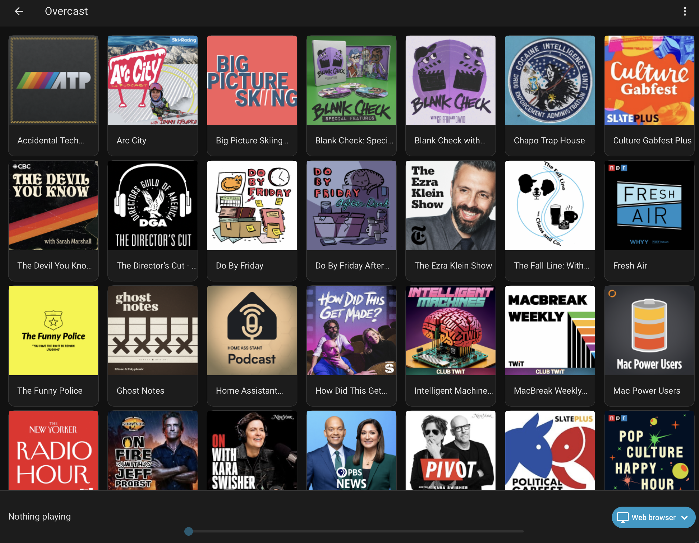
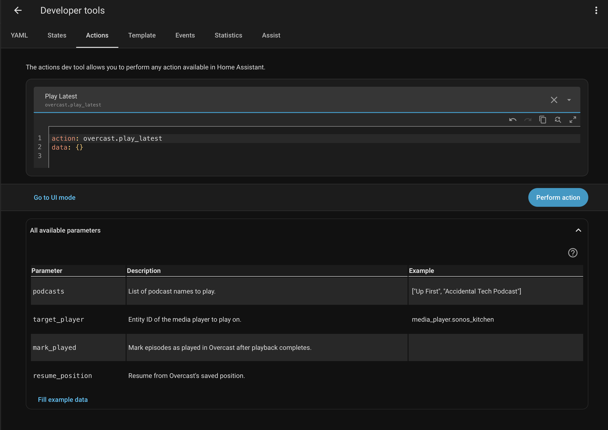

# Overcast for Home Assistant

[](https://hacs.xyz/)
[](https://www.home-assistant.io/)

<p align="center">
  
</p>

A custom integration that plays your [Overcast](https://overcast.fm) podcasts on any Home Assistant media player and sends your listening position back to Overcast.

Overcast has no public API. This integration reads the overcast.fm website the way a browser does, so it can break whenever that website changes.

## What it does

- **Media browser.** Your subscriptions and their episodes show up under Overcast in the media browser. Unplayed episodes have a bullet (•) in front of the title.
- **Play on any speaker.** Sonos, Chromecast, or any `media_player` that plays an audio URL.
- **Progress sync, one way.** While an episode plays, Home Assistant sends the speaker's position to Overcast every 30 seconds and again when you pause or stop. When an episode starts, it reads the saved Overcast position once and resumes from there. Nothing flows the other way during playback — if you carry on listening on your phone, Home Assistant doesn't follow along.
- **Mark played at the end.** An episode is marked played only when the player goes idle within 60 seconds of the end and `mark_played` is on. Stopping early saves your position and never marks it played. So does the player turning off or going unavailable.
- **Queue.** `overcast.play_latest` with several podcasts plays the first now and starts the next on the same player each time an episode reaches its end. Stopping by hand, or playing something else on that player, clears the queue.
- **Speed reporting.** You can tell Overcast which speed you listened at. The player's actual speed doesn't change — Home Assistant has no speed control for media players.

## Screenshots

| Setup | Media browser | Actions |
|:-----:|:------------:|:--------:|
|  |  |  |

## Install

### HACS

1. Open HACS in Home Assistant.
2. Open the three-dot menu and choose **Custom repositories**.
3. Add `https://github.com/nickpdawson/OvercastAssistant` with type **Integration**.
4. Search for "Overcast", install it, and restart Home Assistant.

### Manual

Copy `custom_components/overcast` into your Home Assistant `config/custom_components/` folder and restart.

## Set up

1. Go to **Settings → Devices & services → Add integration** and pick **Overcast**.
2. Choose how to log in:
   - **Email and password.** The password goes to overcast.fm once and isn't stored.
   - **QR code.** Scan the code with the camera on the iPhone or iPad that runs Overcast and approve the login in the app. If the image doesn't show, open the `overcast:///auth?...` link on that device instead. The step finishes on its own once Overcast approves it, and the code expires after 5 minutes.
3. Your subscriptions appear in the media browser.

When the saved login stops working, Home Assistant asks you to log in again under **Settings → Devices & services**. Use either method. An email login for a different account than the one set up is refused.

### Options

**Mark played when an episode ends** (on by default) applies to episodes you start from the media browser. Episodes started by `overcast.play_latest` use that action's `mark_played` field.

## Actions

### `overcast.play_latest`

Plays the newest unplayed episode of each named podcast. The first plays now and the rest are queued on the same player.

| Field | Required | Default | Description |
|-------|----------|---------|-------------|
| `podcasts` | Yes | | Podcast names, as a list or a single name. An exact title match (ignoring case) wins; otherwise the first title that contains the text. |
| `target_player` | Yes | | The `media_player` to play on. |
| `mark_played` | No | `true` | Mark each episode played when it plays to within a minute of the end. |
| `resume_position` | No | `true` | Start from the position saved in Overcast. |
| `speed` | No | Overcast's setting for the podcast | Speed to record in Overcast, 0.75 to 2.25. |
| `config_entry_id` | No | | Which Overcast account to use. Only needed with more than one. |

### `overcast.mark_played`

Marks an episode played without playing it.

| Field | Required | Description |
|-------|----------|-------------|
| `episode_url` | Yes | An `https://overcast.fm/+...` episode link. Anything else, including other hosts, is rejected. |
| `config_entry_id` | No | Which Overcast account to use. |

### `overcast.refresh`

Reloads subscriptions and drops cached episode lists. `config_entry_id` is optional; leave it out to refresh every account.

### Example

```yaml
automation:
  - alias: "Morning podcasts"
    triggers:
      - trigger: time
        at: "07:00:00"
    conditions:
      - condition: state
        entity_id: binary_sensor.someone_home
        state: "on"
    actions:
      - action: media_player.volume_set
        target:
          entity_id: media_player.kitchen
        data:
          volume_level: 0.35
      - action: overcast.play_latest
        data:
          podcasts:
            - "Up First"
            - "Accidental Tech Podcast"
          target_player: media_player.kitchen
```

More in [`sample_automations.yaml`](sample_automations.yaml).

## How it works

1. **Login.** Overcast sets a session cookie named `o` after an email login or an approved QR login. The integration keeps that cookie and sends it only to `https://overcast.fm`.
2. **Subscriptions and episodes** come from the HTML of `overcast.fm/podcasts` and each podcast page.
3. **Audio** is the podcast's own file URL (Megaphone, Podtrac and so on). The speaker fetches it directly; Home Assistant doesn't proxy it.
4. **Progress.** The integration watches the player's state and position and POSTs changes to Overcast's `set_progress` endpoint, at most every 30 seconds while playing, plus once on pause or stop. An unchanged position isn't sent again.
5. **Mark played** sends Overcast's "finished" value (`p=2147483647`) to the same endpoint.

How often it talks to overcast.fm: the subscription list once an hour, a podcast's episode list at most every 5 minutes while you browse it, one episode page per episode played, and the progress calls above.

## Privacy

The Overcast session cookie is stored in plain text in Home Assistant's config entry storage (`.storage/core.config_entries`), along with your email if you used email login. Your password isn't stored. Anyone with that file, or a Home Assistant backup that contains it, can use your Overcast account until the cookie expires. Treat backups with that in mind.

Removing the integration deletes the cookie from Home Assistant. It doesn't log that session out on Overcast's side.

## Terms of service and scraping

This integration isn't made or endorsed by Overcast. It automates the overcast.fm website, which Overcast doesn't offer as an API. Read Overcast's terms and decide for yourself whether you're comfortable with that. Overcast can change or block the website at any time, and when it does this integration stops working until someone updates it.

## Debug logging

Add this to `configuration.yaml` and restart, then reproduce the problem and check **Settings → System → Logs**:

```yaml
logger:
  default: warning
  logs:
    custom_components.overcast: debug
```

Debug logs include episode paths and Overcast item ids. They don't include the cookie or password.

## Known limitations

- **No playback speed control.** Speed is only reported to Overcast.
- **Session expiry.** Overcast cookies can expire without warning. Home Assistant then asks you to log in again.
- **QR reauth can't check the account.** A QR login doesn't tell the integration which account approved it, so reauth by QR accepts any account. Use email login if that matters.
- **Signed audio URLs.** Some private or Patreon feeds use time-limited URLs. Play episodes soon after browsing them.
- **One account in the media browser.** With more than one Overcast account set up, the media browser uses the first.
- **Website changes.** If the integration breaks after an Overcast update, please [open an issue](https://github.com/nickpdawson/OvercastAssistant/issues).

## Changes in 0.2.0

- `overcast.mark_played` only accepts `https://overcast.fm/+...` links. Before, a crafted URL could send your session cookie to another host.
- Stopping an episode early no longer marks it played. It's marked played only when the player goes idle within 60 seconds of the end.
- The `play_latest` queue now works. Before, only the first podcast played.
- Episodes played from the media browser now sync progress, resume from the saved position, and follow the new **Mark played** option.
- QR login works: it shows a scannable code and finishes on its own when you approve it in the app.
- Bad action input (no matching podcast, a bad URL, no account loaded) fails the action with an error instead of only writing to the log.
- If overcast.fm is unreachable at startup, Home Assistant retries later instead of asking you to log in again.
- `speed` is a number now. Quoted values like `"1.25"` still work.

## License

MIT
